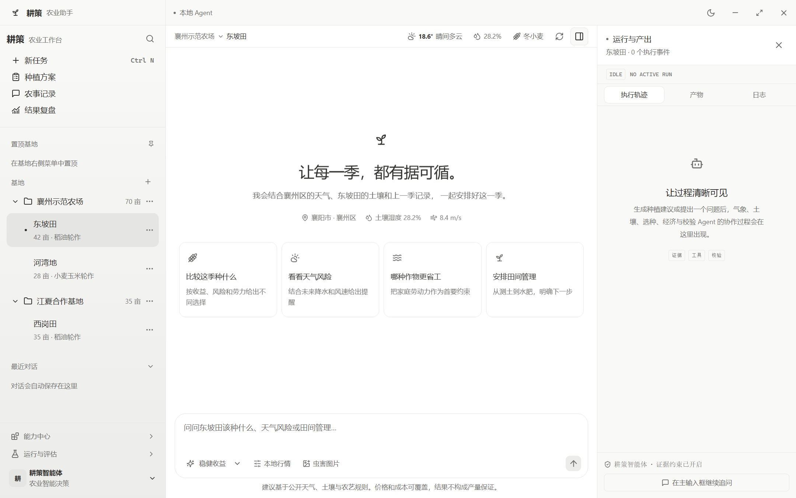
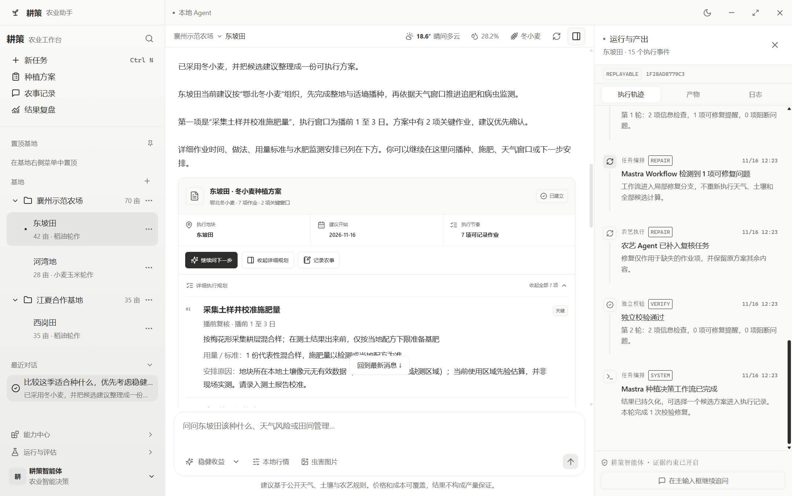
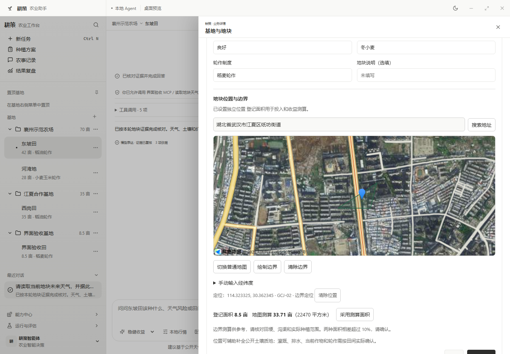

# 耕策

耕策是一套面向小型家庭农场和大型合作社的桌面农业智能体。它以连续对话为入口，把位置环境、天气、土壤、作物规则和市场估算组织成可解释的种植建议，并继续连接方案、农事执行、实际结果与下一轮反馈。

项目不接入传感器、农机或灌溉硬件。当前以湖北为首个高置信区域，同时提供全国基础天气、公开土壤数据和通用作物规则；超出高置信范围时会明确降低结论置信度。

## 界面预览







## 选题背景

家庭农场和合作社在种植决策中通常同时面对三类问题：

1. 选种依赖经验，难以比较稳收益、低风险、省工和养地等不同目标。
2. 天气、土壤、区域农技规则和本地行情分散，缺少能落到地块的执行方案。
3. 方案执行后没有统一记录，产量、成本和品质结果难以回到下一季决策。

耕策针对上述断点，将“问答”扩展为一条可追踪的农业决策链路：

```text
选择基地与地块
  -> 读取位置、天气、土壤和历史信息
  -> 按用户目标比较作物候选
  -> 输出可解释方案与风险提醒
  -> 用户采用方案
  -> 记录农事执行
  -> 提交实际结果与反馈
  -> 形成下一次决策依据
```

## 核心能力

- **地块级环境分析**：读取地块坐标，查询天气、降雨、风速、蒸散和公开土壤属性；支持地图选点、手动测土与区域先验降级。
- **分目标选种**：按稳收益、低风险、省工易管、养地轮作分别排序，不隐藏收益、劳动力和风险之间的取舍。
- **本地行情覆盖**：公开价格、产量和成本只作为估算区间，用户可以录入当地收购价、预期亩产和现金成本重新计算。
- **完整业务闭环**：候选方案可转为正式种植方案，并继续关联农事记录、实际产量、品质、收入、成本和用户评分。
- **多 Agent 协作**：气象、土壤、选种、经济、农艺和独立验证等专业 Agent 通过结构化产物交接，运行事件可实时查看并持久化回放。
- **能力中心**：提供 MCP 服务、Skills 和本地知识库管理；个人技能支持创建、复制、导入、编辑、发布和按账号/基地/地块绑定。
- **虫害图片初筛**：调用视觉模型输出候选、可见依据、补拍建议和地块历史，不生成农药处方。
- **多基地管理**：一个演示账号可管理多个基地和地块，基地、地块、方案、作业和结果均保存在本地 SQLite。

## 技术架构

```text
Electron 桌面窗口
  ├─ React + TypeScript 对话与业务界面
  ├─ 受限 preload bridge
  └─ 本地 HTTP/SSE 服务
       ├─ Mastra Agent / Workflow
       ├─ Open-Meteo / SoilGrids / 区域规则
       ├─ MCP / Skills / 知识库
       ├─ DeepSeek 或千问兼容接口
       └─ SQLite 持久化
```

Mastra 负责 Agent 注册、工作流编排、运行生命周期和能力快照。天气、土壤、经济计算、季节窗口、轮作和关键安全判断仍由可测试的确定性代码完成，模型只负责受证据约束的表达与视觉观察。

详细设计见 [系统架构](docs/architecture.md) 和 [项目白皮书](docs/assets/耕策技术白皮书.pdf)。

## 快速启动

环境要求：

- Node.js 24
- pnpm 11
- Windows 10/11（桌面主交付）

```powershell
pnpm install
Copy-Item .env.example .env
pnpm desktop
```

`pnpm desktop` 会构建前端和本地服务，再启动 Electron 窗口。未配置模型密钥时，系统进入确定性演示模式，完整业务流程仍可使用。

浏览器调试模式：

```powershell
pnpm dev
```

- Web：`http://localhost:5173`
- API：`http://localhost:8787`

浏览器入口用于开发和自动化验收，产品主交付为 Electron 桌面应用。

## Docker 一键启动

```powershell
Copy-Item .env.example .env
docker compose up --build
```

启动后访问 `http://localhost:8787`。业务数据库保存在具名卷 `agriculture-data` 中。Docker 模式用于复现部署、接口检查和评审环境。

## 桌面打包

```powershell
pnpm desktop:package
```

Windows x64 产物位于：

```text
release/Gengce-win32-x64/Gengce.exe
```

## 模型配置

模型密钥只存放在服务端 `.env`，不会进入前端代码或安装包。

DeepSeek：

```dotenv
MODEL_PROVIDER=deepseek
MODEL_BASE_URL=https://api.deepseek.com
MODEL_API_KEY=your-server-side-key
MODEL_NAME=deepseek-chat
```

阿里云百炼 / 千问：

```dotenv
MODEL_PROVIDER=qwen
MODEL_BASE_URL=https://dashscope.aliyuncs.com/compatible-mode/v1
MODEL_API_KEY=your-server-side-key
MODEL_NAME=qwen3-max
MODEL_SUMMARY_NAME=qwen3-max
MODEL_VISION_NAME=qwen3-vl-plus
```

若控制台提供业务空间专属地址，请将 `MODEL_BASE_URL` 替换为对应的 `.../compatible-mode/v1` 地址。也可以使用 `DASHSCOPE_API_KEY` 作为密钥别名。

## 数据与边界

- 湖北为首个高置信规则区；其他地区使用全国基础天气、公开土壤与通用作物规则，并降低结论置信度。
- 当前作物池包括水稻、油菜、小麦、玉米和大豆，其中水稻、油菜和小麦提供更完整的农事指导。
- 天气来自 Open-Meteo；公开土壤来自 SoilGrids；区域农事规则来自公开农技资料。
- 价格、产量和成本是公开估算，不是实时收购报价，也不构成产量或收益保证。
- 虫害识别结果用于初步筛查，不替代当地植保部门、持证农技人员或农药标签。
- 演示账号、基地、地块、历史和结果均为可识别的合成数据。
- 产品不接入硬件，不执行自动灌溉、施肥或农机控制。

## 主要目录

```text
server/            本地 API、SQLite、Mastra、MCP、知识与确定性工具
src/               React 桌面界面
desktop/           Electron 主进程与 preload bridge
docs/              架构、需求、部署、Skills 与验收文档
scripts/           数据准备、验收、打包和白皮书生成脚本
tests/             Agent、能力中心、地块管理和启动恢复测试
data/              湖北公开土壤数据与运行时数据库
```

## 验证

```powershell
pnpm typecheck
pnpm test
pnpm build
pnpm check:ui
pnpm check:desktop
```

`check:ui` 会使用本机 Edge 执行真实交互，并将验收截图写入 `test-results/ui/`。`check:desktop` 会启动 Electron，验证 preload bridge、本地服务、模型状态和完整运行链路。

## 文档

- [选题与场景需求](docs/requirements.md)
- [系统架构](docs/architecture.md)
- [部署指南](docs/deployment.md)
- [Skills 与能力中心](docs/skills.md)
- [演示流程](docs/demo-script.md)
- [验收记录](docs/workflow-acceptance.md)
- [赛道提交说明](docs/submission.md)
- [耕策技术白皮书](docs/assets/耕策技术白皮书.pdf)

## 接口概览

| 方法 | 路径 | 用途 |
| --- | --- | --- |
| GET | `/api/bootstrap` | 初始化账号、基地、地块与业务数据 |
| POST | `/api/runs` | 发起选种或问答 Agent 任务 |
| GET | `/api/runs/:id/events` | SSE 读取运行轨迹 |
| POST | `/api/plans` | 采用候选并建立正式方案 |
| POST | `/api/plans/:id/records` | 新增农事记录 |
| POST | `/api/plans/:id/outcome` | 提交实际结果 |
| POST | `/api/plans/:id/feedback` | 提交方案反馈 |
| POST | `/api/plots/:id/context/refresh` | 刷新天气与土壤上下文 |
| GET | `/api/capabilities` | 读取 MCP、Skills 与知识库汇总 |
| POST | `/api/pest-assessments` | 提交虫害图片初筛 |
